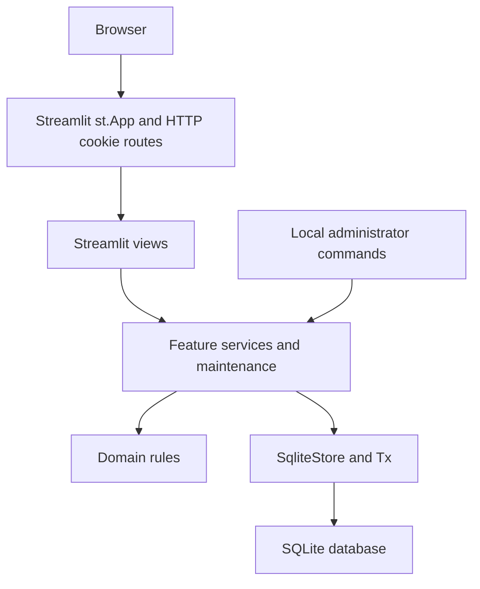
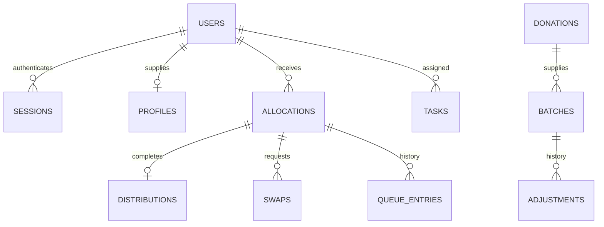

# FoodShare Tracker: current implementation

## Architecture



## Receive donation

```mermaid
sequenceDiagram
    actor Worker as Staff or assigned Volunteer
    participant UI as Receiving view
    participant Service as Donation service
    participant DB as SqliteStore and Tx
    Worker->>UI: Confirm accepted items and label information
    UI->>Service: receive_donation
    Service->>DB: Begin immediate; load donation and current task
    alt Valid and not received
        Service->>DB: Insert batches, receipt history and audit
        Service->>DB: Mark donation Collected; commit
        Service-->>UI: Receipt confirmation
    else Invalid or repeated receipt
        Service->>DB: Roll back all business writes
        Service-->>UI: Respectful error
    end
```

## Collect allocation

```mermaid
sequenceDiagram
    actor Worker as Staff or assigned Volunteer
    participant UI as Collection view
    participant Service as Allocation service
    participant Rules as Domain rules
    participant DB as SqliteStore and Tx
    Worker->>UI: Confirm actual quantities and any late exception
    UI->>Service: record_collection
    Service->>DB: Begin immediate; load current account, needs and stock
    Service->>Rules: Recheck dates, allergies, holds and quantities
    alt All checks pass
        Service->>DB: Deduct stock; write distribution and stock history
        Service->>DB: Complete queue entry; close swaps; append audit; commit
        Service-->>UI: Collection recorded once
    else Unsafe, inactive, stale or already collected
        Service->>DB: Roll back all business writes
        opt Expired or held food refusal
            Service->>DB: Append redacted Denied audit in a new transaction
        end
        Service-->>UI: Error; no partial distribution
    end
```

## Approve swap

```mermaid
sequenceDiagram
    actor Worker as Staff
    participant UI as Swap review view
    participant Service as Swap service
    participant DB as SqliteStore and Tx
    Worker->>UI: Choose safe replacement and quantity
    UI->>Service: approve_swap with loaded request version
    Service->>DB: Persist lifecycle closures; begin immediate decision
    alt Current Pending request and valid replacement
        Service->>DB: Change item batch and quantity; preserve physical stock
        Service->>DB: Mark Approved; insert notice and audit; commit
        Service-->>UI: Approved
    else Closed, stale or unsuitable
        Service->>DB: Roll back decision writes
        Service-->>UI: Reload or choose suitable food
    end
```

## Anonymous feedback

```mermaid
sequenceDiagram
    actor Person as Visitor
    participant UI as Public feedback view
    participant Tokens as Anonymous memory controls
    participant Service as Feedback service
    participant DB as SqliteStore and Tx
    Person->>UI: Write 1 to 500 characters
    UI->>Tokens: Obtain transient browser token and single-use form
    UI->>Service: Submit message and tokens without account identity
    Service->>Tokens: Check expiry, binding, replay and five-per-ten-minute quota
    alt Valid submission
        Service->>DB: Insert message, date and review flags; commit
        Service->>Tokens: Consume form and count success
        Service-->>UI: Thank-you after saved record
    else Invalid, replayed or rate limited
        Service-->>UI: Respectful guidance; no feedback record
    end
```

## Record relationships



These are logical ID relationships; nested allocation/donation item lists remain JSON columns. SQLite does not declare every logical relationship as a foreign key. Feedback has no submitter relationship.
